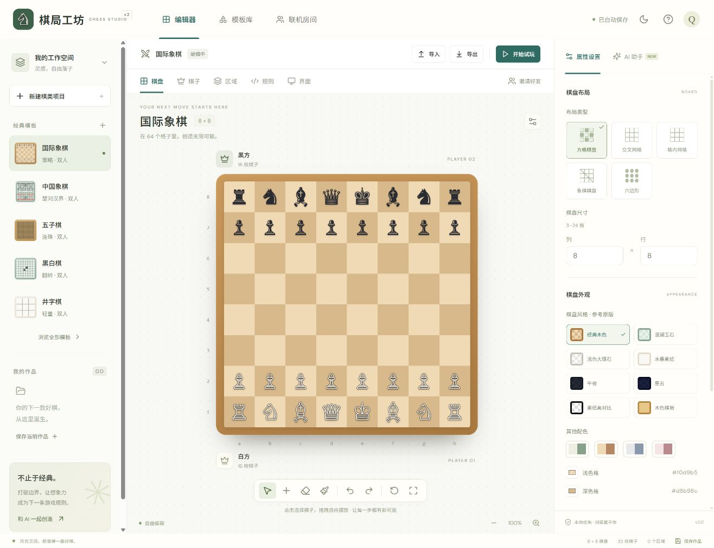

# 棋局工坊 v2 · Chess Studio

在浏览器里设计一款棋：从经典模板开始，调整棋盘和棋子，编写自己的规则，或者让 AI 帮你把想法变成可以试玩的作品。

**[在线体验](https://xuyinjiesh.github.io/chess-editor/)** · [快速开始](#快速开始) · [AI 设计](#用-ai-设计棋类) · [部署说明](#部署到-github-pages) · [开发文档](docs/DEVELOPMENT.md)

## 界面预览



*国际象棋模板与棋盘外观设置。试玩时可以放大棋盘，专注对弈。*

## 可以做什么

| 功能 | 用法 |
| --- | --- |
| 设计棋盘 | 调整 3–24 行列，选择方格、交叉网格、格内网格、象棋或六边形布局 |
| 自定义棋子 | 创建棋子类型，修改双方符号与外观，点击或拖拽摆放 |
| 标记区域 | 绘制带颜色和标签的区域，供自定义规则使用 |
| 自由编写规则 | 用 JavaScript 定义走法、回合和胜负，支持规则试运行 |
| 本地人机对弈 | 内置棋类与自定义规则，三档难度、先后手、暂停、悔棋及电脑自我对弈 |
| AI 辅助设计 | 描述想法，生成棋盘、棋子、区域、规则和界面设置，预览后应用 |
| 保存与分享 | 浏览器自动保存、本地作品库、JSON 导入和导出 |
| 静态作品广场 | 搜索作品、查看玩法、独立试玩与 AI 对弈、固定版本分享、下载与复制改编 |
| 联机对弈 | 创建房间，分享房间码或链接，邀请朋友加入或观战 |
| 调整观感 | 8 套棋盘主题、自定义配色、夜间模式、翻转、缩放和走子动效 |

内置 **国际象棋、中国象棋、五子棋、黑白棋和井字棋**。每个模板都可以直接试玩，也可以作为新棋类的起点。

## 快速开始

### 直接使用

打开[在线体验](https://xuyinjiesh.github.io/chess-editor/)，无需安装。

1. 在左侧选择一个经典模板，或新建项目。
2. 用上方的「棋盘」「棋子」「区域」「规则」「界面」调整设计。
3. 点击「开始试玩」，检查棋子走法和游戏规则。
4. 点击「保存作品」保存在当前浏览器，或「导出」为 JSON 文件。

试玩时点击「放大棋盘」或按 `G` 可以隐藏侧栏；按 `Esc` 返回，棋局会保留。

### 本地运行

需要安装 Node.js 22.6 或更新版本，推荐使用较新的 **Node.js 22** 或 **Node.js 24**。

```sh
git clone https://github.com/xuyinjiesh/chess-editor.git
cd chess-editor
npm ci
npm run dev
```

打开终端显示的地址，默认是 `http://localhost:5173`。

## 用 AI 设计棋类

在右侧打开 **AI 助手 → 配置模型**，填写兼容 Chat Completions 的 API 地址、模型名称和 API Key，然后描述你的想法。例如：

> 设计一个 8×8 的双人棋。双方各有三名守卫和一名国王；守卫每次横向或纵向移动一格，进入中央区域可以额外行动一次，吃掉对方国王获胜。

AI 会生成完整设计，包括可执行的规则代码。**先查看预览，再点击「应用这个设计」**；也可以继续手动修改。

- 使用你自己的模型服务；项目没有内置 API Key，服务商可能收费。
- 模型接口需要允许浏览器跨域访问（CORS）。
- API Key 只保留在当前页面内存中，刷新后清除；当前项目与描述会发送给你配置的模型服务。
- AI 可以调整名称、简介、强调色和提示等界面设置；目前不支持运行 AI 生成的任意 HTML 页面。

## 和电脑对弈

点击顶栏 **人机对弈**，选择阵营和难度，然后开始新对局。引擎在本机浏览器运行，不需要模型接口或 API Key，也可选择观看电脑自我对弈。原来的「开始试玩」仍用于本机双人操作。

内置五种棋类均可使用。自定义棋类支持双人、完全信息、确定性的回合制规则，包括额外回合；AI 助手会同时生成合法走法和局面评价函数。已有设计可在 AI 助手中选择「保持当前玩法，为人机对弈补齐 getLegalMoves 和 evaluate」，预览后应用。旧规则也可尝试兼容搜索，复杂规则建议补齐接口。

电脑可暂停或重试；人机悔棋会撤回自己的走子及电脑的回应。具体规则接口、适用范围与限制见[本地 AI 说明](docs/LOCAL_AI.md)。

## 发布自己的作品

目前广场展示五款棋，均支持双人试玩及本地 AI。本站原创的**足球棋**可移动、带球、抢球、蓄力与传射，踢球或带球入门获胜；**角斗棋**在 3 × 3 棋盘上调配十六枚储备，每方最多同时上场三子，吃将获胜。操作选项、持球标记与储备数量直接显示在试玩页，复制到编辑器后仍可使用。

另外三款为迷你永恒棋、震棋与形意棋（Onitama）：分别支持开局布阵与吃子后放回、同时击退周围棋子、五张招式流转及擒师／入庙获胜。详情页提供这些作品的原规则／视频来源与权利说明，其公开授权状态尚未核实。

顶栏「作品广场」集中展示已发布的棋类，支持搜索、分类、玩法介绍、电脑对弈和版本分享。浏览和试玩会保留编辑器草稿；复制改编时会先将原草稿保存到本地作品库。

只有你发布作品时，无需增加后端：在编辑器点击「发布」导出发布包，然后在项目目录运行：

```sh
npm run gallery:add -- "你的作品-v1.qijing-release.json"
npm run build
npm run preview
```

确认后提交生成的 `public/gallery/` 文件并推送，随网站一起部署。更新作品时增加版本号，旧分享链接继续有效。完整流程见[静态作品广场说明](docs/STATIC_GALLERY.md)。

## 和朋友联机

打开顶栏「联机房间」，填写昵称，用当前项目创建房间，再分享房间码或邀请链接。

| 方式 | 适用场景 |
| --- | --- |
| 房主托管 | 默认方式，由房主浏览器处理规则，通过 WebRTC 同步对局 |
| 指定服务器 | 使用自己部署的 WebSocket 中继，适合需要统一服务器地址的场景 |

房主执白方（中国象棋为红方），第一位加入者执黑方，其他人观战；每个房间最多 8 人。**房主需要保持页面打开**。连接受网络环境影响，必要时可配置 TURN 或使用指定服务器。

自建中继可以运行 `npm run server`。服务器地址、TLS 和信令配置见[联机部署说明](docs/DEVELOPMENT.md#联机部署)。

## 常用快捷键

Windows / Linux 使用 `Ctrl`，macOS 使用 `⌘`。

| 快捷键 | 操作 |
| --- | --- |
| `Ctrl / ⌘ S` | 保存作品 |
| `Ctrl / ⌘ Shift S` / `Ctrl / ⌘ O` | 导出 / 导入 |
| `Ctrl / ⌘ Z` / `Ctrl / ⌘ Shift Z` / `Ctrl / ⌘ Y` | 撤销 / 重做 |
| `Space` | 切换编辑 / 试玩；焦点在普通按钮时激活按钮 |
| `V` / `P` / `E` / `R` | 选择 / 放置棋子 / 擦除 / 绘制区域 |
| `1`–`9` / `Delete` | 选择棋子类型 / 删除选中棋子 |
| `F` / `D` / `G` | 翻转棋盘 / 切换夜间模式 / 放大棋盘 |
| `+` / `−` / `0` | 放大 / 缩小 / 还原缩放 |
| `Esc` / `?` | 取消选择或退出放大 / 打开使用指南 |

在输入框中编辑文字时，棋盘操作快捷键会暂停。

## 部署到 GitHub Pages

仓库包含自动部署工作流。首次部署只需：

1. 进入仓库 **Settings → Pages → Build and deployment**。
2. 将 **Source** 设为 **GitHub Actions**。
3. 将修改推送到 `main`；也可以在 **Actions → Deploy to GitHub Pages → Run workflow** 中选择 `main` 手动运行。
4. 等待工作流成功，访问 `https://xuyinjiesh.github.io/chess-editor/`。

工作流会安装依赖、运行测试、按仓库子路径构建并发布 `dist/`。**不要直接把源码根目录作为网站发布**，否则浏览器无法加载 React / TypeScript 入口。

部署到其他静态托管平台时，运行 `npm run build`，发布生成的 `dist/` 即可。

## 使用前了解

- **保存位置**：作品保存在当前浏览器中，不会自动同步到其他设备。重要设计建议导出 JSON 备份。
- **导出内容**：JSON 保存棋类设计与初始布局，不包含正在进行的对局和棋谱。
- **规则范围**：当前支持两方阵营。区域效果由自定义规则解释；六边形布局的邻接关系也需要自行定义。
- **中国象棋**：支持基本合法走法、将军、将死和困毙判负；尚未实现长将、长捉和自然限着等竞赛裁定。
- **联机范围**：面向朋友间对弈，暂不提供自动重连、房主迁移或竞技防作弊。

## 开发与扩展

项目使用 React、TypeScript 和 Vite；国际象棋规则基于 chess.js，P2P 联机使用 PeerJS。

```sh
npm test         # 运行自动测试
npm run build    # 类型检查与生产构建
npm run preview  # 预览构建结果
```

- [开发文档](docs/DEVELOPMENT.md)：项目格式、自定义规则协议、AI 接口和联机部署。
- [测试记录](TESTING.md)：自动测试范围与已完成的浏览器验证。

棋盘与棋子样式延续第一版的设计。应用版本为 `2.0.0`；JSON 项目格式仍为 `version: 1`，可继续导入旧版设计文件。
